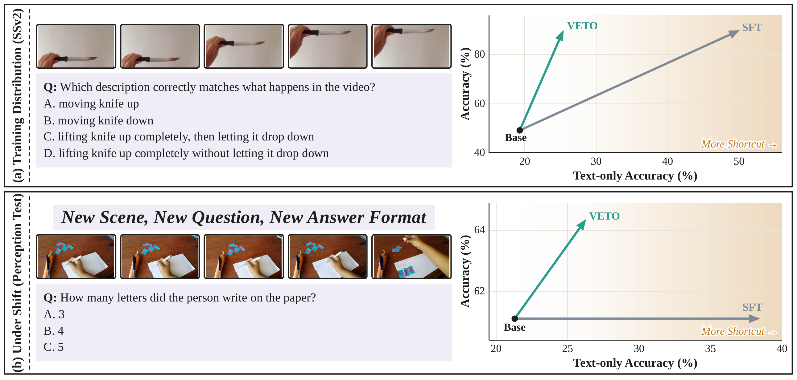
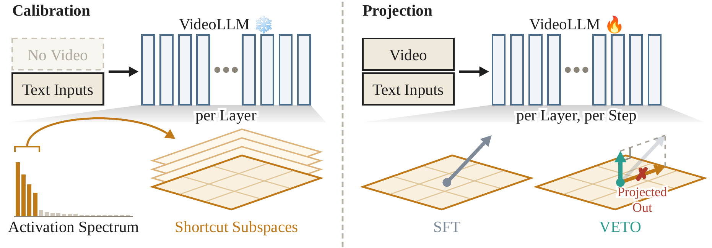

# VETO: Suppressing the Shortcut Hidden Behind the Gains of VideoLLM Fine-Tuning

<div align="center">

[](https://arxiv.org/abs/2611.25776)&nbsp;

</div>

<p align="center">

</p>

<p align="center">
<i><b>SFT raises the dependency on a shortcut, answering from the text alone; VETO suppresses it.</b>
(a) In distribution (SSv2), the two look alike in accuracy. (b) Under shift (Perception Test), VETO
generalizes better with less shortcut dependency.</i>
</p>

<br>

## 📣 Update Logs

- 🚧 Code coming soon

## 📝 Abstract

Supervised fine-tuning (SFT) is the stage in which Video Large Language Models (VideoLLMs) advance their capability to reason over video. However, the VideoLLM also learns to answer from textual regularities of its training data, a shortcut that bypasses the video. The regularities behind the shortcut are hard to define at the data level, and the shortcut forms regardless of training epoch, data size, or backbone. The shortcut is hidden behind a rise in accuracy within the training distribution, yet it is not required for the rise and even costs SFT the gain the video offers under distribution shift. We therefore propose Video-Evidence Training via Orthogonal projection (VETO), which intervenes on the fine-tuning update where the shortcut is written rather than on the data. VETO calibrates the subspace that the text alone occupies in the activations of the base model and projects the update onto its orthogonal complement. The VideoLLM is thus left to ground its answer in the full input, with the shortcut suppressed as it forms and never defined. Across seven VideoLLMs, VETO preserves the gain of SFT on the training distribution and suppresses the shortcut. On six benchmarks under shift it gains more than SFT and answers from the full input rather than the shortcut.

### 💡 Keeping the Update Out of the Text-Only Subspace

<p align="center">

</p>

**Calibration** ❄️: once per VideoLLM, the frozen base model reads the text-only input of 400
calibration items. For each adapted module, the uncentered second moment of its input is
eigendecomposed, and the leading eigenvectors that carry a fraction ρ = 0.95 of the spectrum form the
basis `U` of the shortcut subspace.

**Projection** 🔥: LoRA parameterizes the update as `ΔW = B A`. After initialization and after every
optimizer step, the input factor is projected, `A ← A − (A U) Uᵀ`, so that `ΔW U = 0`. The update can
change what the model does with the video, but not what it does with the question alone.

The projection is `veto/subspace.py::project_lora`, and the subspace is
`veto/subspace.py::leading_subspace`.

## 🧩 What's Inside

Calibration, constrained fine-tuning, and evaluation with the full input and from the text alone,
for seven VideoLLMs.

| VideoLLM | `--family` |
| --- | --- |
| Qwen2.5-VL-3B, 7B, 32B | - (default) |
| Qwen3-VL-8B | `qwen3vl` |
| LLaVA-OneVision-7B | `llavaov` |
| Molmo2-O-7B | `molmo2` |
| Gemma4-E2B | `gemma4` |

To add VETO to a training loop of your own, see [Use VETO in your own code](#-use-veto-in-your-own-code).

## 🛠️ Setup

```bash
pip install -r requirements.txt
```

Tested with Python 3.10, PyTorch 2.11, Transformers 4.57.1, and PEFT 0.20.0 on one NVIDIA
B200 per run. Setting `ATTN_IMPL=flash_attention_2` uses flash-attn when it is installed.

## 📦 Data

Every split is a JSONL manifest with one multiple-choice item per line.

```json
{"id": "ssv2_197895", "video": "/path/197895.webm", "question": "...", "options": ["...", "..."], "answer": "C", "dim": "camera_horizontal"}
```

`video` is a video file or a directory of pre-extracted frames `f*.png`. `dim`, the family of the
item, is needed only in the training data, where it stratifies the calibration sample. No data is
distributed with this repository.

### Training distribution and blind filtering

The training data is filtered before fine-tuning: an item is removed when the base model answers
it from the text alone under three option orders. We use Something-Something V2, and any
multiple-choice video QA data in the manifest format works the same way.

1. Build the manifests. For SSv2, download the videos and the labels of
   [Something-Something V2](https://www.qualcomm.com/developer/software/something-something-v2-dataset).

   ```bash
   python tools/make_ssv2_manifest.py --labels ssv2/labels/train.json \
       --video_dir ssv2/videos --out ssv2_train.jsonl
   python tools/make_ssv2_manifest.py --labels ssv2/labels/validation.json \
       --video_dir ssv2/videos --out ssv2_val.jsonl
   ```

2. Blind filtering.

   ```bash
   python tools/blind_filter.py --model_name Qwen/Qwen2.5-VL-7B-Instruct \
       --data ssv2_train.jsonl ssv2_val.jsonl --n_perm 3 --out_prefix blindfilt
   ```

3. Build the training, selection, test, and calibration splits.

   ```bash
   python tools/prepare_splits.py --train blindfilt_ssv2_train_hard.jsonl \
       --val blindfilt_ssv2_val_hard.jsonl --out_dir data
   ```

### Evaluation under shift

Download the multiple-choice annotations and the videos of
[Perception Test](https://github.com/google-deepmind/perception_test).

Every evaluation set is blind-filtered with the same rule as the training data, and all results
under the shift are reported on the filtered subset.

```bash
python tools/make_perception_manifest.py --root perception_test --out_dir data
python tools/blind_filter.py --model_name Qwen/Qwen2.5-VL-7B-Instruct \
    --data data/perception_full.jsonl --n_perm 3 --out_prefix data/blindfilt   # data/blindfilt_perception_full_hard.jsonl
```

Any other multiple-choice benchmark is evaluated by writing it in the manifest format and
blind-filtering it.

## 🚀 Usage

```bash
# 1) calibration
python tools/calibrate.py --model_name Qwen/Qwen2.5-VL-7B-Instruct \
    --calib_data data/calib400.jsonl --out projectors.npz

# 2) fine-tuning with VETO, or SFT without --projectors
python tools/train.py --train_data data/train.jsonl --val_data data/val_select.jsonl \
    --projectors projectors.npz --out_dir out/veto_s<seed> --seed <seed>

# 3) evaluation with the full input and from the text alone
python tools/evaluate.py --ckpt out/veto_s<seed>/best.pt --data data/test.jsonl --out veto_s<seed>.json
```

`scripts/run.sh <seed>` runs all three for VETO, SFT, and the base model.

<details>
<summary><b>Other VideoLLMs</b></summary>

The `*_backbones.py` scripts take the same steps with `--family` and `--model_path`.

```bash
python tools/calibrate_backbones.py --family qwen3vl --model_path Qwen/Qwen3-VL-8B-Instruct \
    --calib_data data/calib400.jsonl --out projectors_qwen3vl8b.npz
python tools/train_backbones.py --family qwen3vl --model_path Qwen/Qwen3-VL-8B-Instruct \
    --train_data data/train.jsonl --val_data data/val_select.jsonl --micro_batch 4 \
    --projectors projectors_qwen3vl8b.npz --out_dir out/qwen3vl8b_veto_s<seed> --seed <seed>
python tools/evaluate_backbones.py --family qwen3vl --model_path Qwen/Qwen3-VL-8B-Instruct \
    --ckpt out/qwen3vl8b_veto_s<seed>/best.pt --data data/test.jsonl --out qwen3vl8b_veto_s<seed>.json
```

Gemma 4 needs Transformers 5.5 or later. Keep the default `ATTN_IMPL=sdpa` for Gemma 4 and Molmo2.

</details>

## 🔌 Use VETO in your own code

VETO needs only a LoRA model from [PEFT](https://github.com/huggingface/peft) and two steps from
`veto/subspace.py`, so it drops into any training loop.

```python
import torch
from veto.subspace import SecondMomentCollector, subspaces, project_lora

# every LoRA-wrapped module, and the name of its factor A
lora_mods = {name: {"module": m, "param_A_name": f"{name}.lora_A.default.weight"}
             for name, m in model.named_modules() if hasattr(m, "lora_A") and hasattr(m, "base_layer")}

# 1) calibration: the model reads the question and the options without the video, one item per
#    forward pass. B starts at zero, so this is the base model.
col = SecondMomentCollector(lora_mods)
with torch.no_grad():
    for inputs in textonly_inputs:
        model(**inputs)
U = subspaces(col.second_moment(), rho=0.95)
col.remove()

# 2) fine-tuning: project A after initialization and after every optimizer step
project_lora(model, U, lora_mods)
for inputs in train_inputs:
    model(**inputs).loss.backward()
    optimizer.step()
    optimizer.zero_grad()
    project_lora(model, U, lora_mods)
```

Modules that the text-only input never reaches, such as LoRA on the vision encoder, get no
subspace and are left unconstrained.

## 🗂️ Layout

```
veto/
├── README.md
├── LICENSE
├── requirements.txt
├── assets/                       figures of this README
├── scripts/
│   └── run.sh                    all steps for a single seed
├── tools/
│   ├── make_ssv2_manifest.py     SSv2 labels to multiple-choice manifests
│   ├── blind_filter.py           removal of items solvable from the text alone
│   ├── prepare_splits.py         training, selection, test, and calibration splits
│   ├── make_perception_manifest.py  Perception Test manifest
│   ├── calibrate.py              Qwen2.5-VL calibration
│   ├── train.py                  Qwen2.5-VL fine-tuning, VETO or SFT
│   ├── evaluate.py               Qwen2.5-VL evaluation, full input and text-only
│   ├── calibrate_backbones.py    the same three steps for the other VideoLLMs
│   ├── train_backbones.py
│   └── evaluate_backbones.py
└── veto/
    ├── subspace.py               second moments, subspace, projection
    ├── data.py                   manifests, frame extraction, inputs
    ├── model.py                  Qwen2.5-VL loading, LoRA modules
    ├── backbones.py              loading and LoRA targets of the other VideoLLMs
    └── eval.py                   letter-logit evaluation
```

## 📖 Citation

If this project provided insights or was helpful to your research, please give us a star ⭐ and cite us using:

```bibtex
@misc{shin2026veto,
      title={Suppressing the Shortcut Hidden Behind the Gains of VideoLLM Fine-Tuning},
      author={Youngwoo Shin and Jongsuk Kim and Junmo Kim},
      year={2026},
      eprint={2611.25776},
      archivePrefix={arXiv},
      primaryClass={cs.CV},
      url={https://arxiv.org/abs/2611.25776},
}
```

## License

This project is licensed under the MIT License - see the [LICENSE](./LICENSE) file for details.
